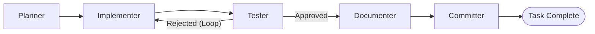

# Multi-Agent Engineering System — Get Idiomas

Autonomous multi-agent development framework for the **AI Writing Correction & Memberships Platform (Get Idiomas)**.

## 1. Overview

This directory (`.agent-system`) houses the operational framework, domain knowledge, agent contracts, state machines, and templates that govern autonomous subagents building the platform.

The system enforces an **AI-First strategy**, prioritizing core backend architecture and LangGraph AI evaluation engine deployment to execute benchmark validations before implementing user interfaces and commercial tiers.



## 2. Directory Structure

```
.agent-system/
├── AGENT_SYSTEM.md          # Multi-agent system architecture & guidelines
├── DEFINITION_OF_DONE.md    # Strict completion criteria for tasks
├── GLOBAL_RULES.md          # Global constraints and non-negotiables
├── README.md                # System documentation (this file)
├── backlog                  # Prioritized sprint backlog (Phases 1-7)
├── requirements             # Formal functional requirements (RF-01 to RF-17)
│
├── knowledge/               # Domain, architectural & technical knowledge
│   ├── PROJECT_CONTEXT.md   # Business model, pedagogy & Cambridge framework
│   ├── TECHNOLOGY_STACK.md  # Languages, frameworks, infrastructure & libraries
│   ├── ARCHITECTURE.md      # Microservice separation, DB schemas & data pipelines
│   ├── BUSINESS_RULES.md    # Cambridge rubric scoring, bands, OCR & licensing rules
│   ├── CODING_STANDARDS.md  # Python, TypeScript, API & database conventions
│   └── SECURITY_RULES.md    # ZDR, GDPR, authentication & role authorization
│
├── agents/                  # Role specifications, contracts & specialized skills
│   ├── planner/             # Technical specifications & dependency analysis
│   ├── implementer/         # Code writing across backend, AI, DB, & frontend
│   ├── tester/              # Verification, automated testing & regression checks
│   ├── documenter/          # Technical docs, OpenAPI sync & changelog updates
│   └── committer/           # Code review, Git hygiene & Conventional Commits
│
├── workflows/               # Execution rules and governance
│   ├── TASK_LIFECYCLE.md    # State transitions from Backlog to Released
│   ├── DEVELOPMENT_WORKFLOW.md # Inter-agent handoff mechanics and execution steps
│   ├── APPROVAL_POLICIES.md # Human-in-the-loop gates and automated criteria
│   └── ERROR_HANDLING.md    # Fallback strategies, retries and deadlock resolution
│
├── state/                   # Live runtime state tracking
│   ├── CURRENT_TASK.md      # Active task specification and progress
│   ├── EXECUTION_STATUS.md  # Overall backlog progress across phases
│   └── AGENT_HANDOFF.md     # Inter-agent payload and communication baton
│
├── templates/               # Standardized markdown formats
│   ├── TASK_SPEC_TEMPLATE.md
│   ├── IMPLEMENTATION_REPORT_TEMPLATE.md
│   ├── TEST_REPORT_TEMPLATE.md
│   ├── CHANGELOG_TEMPLATE.md
│   └── ADR_TEMPLATE.md
│
└── contracts/               # JSON Schema contracts for inter-agent artifacts
    ├── task_spec.schema.json
    ├── implementation_report.schema.json
    ├── test_report.schema.json
    ├── documentation_report.schema.json
    └── commit_report.schema.json
```

## 3. Subagents Roster

| Subagent | Role | Primary Artifact Output | Hand off to |
| :--- | :--- | :--- | :--- |
| **Planner** | Software Architect & Technical Planner | `task_spec.md` | Implementer |
| **Implementer** | Full-Stack & AI Systems Developer | `implementation_report.md` | Tester |
| **Tester** | QA & Security Verification Specialist | `test_report.md` | Documenter (if pass) / Implementer (if fail) |
| **Documenter** | Technical Writer & API Documenter | `documentation_report.md` | Committer |
| **Committer** | Release Engineer & VCS Controller | `commit_report.md` | State Complete |

## 4. Execution Workflow

1. **Pick Task**: Planner selects the next priority task from `backlog`.
2. **Technical Plan**: Planner analyzes the codebase and generates a comprehensive `task_spec.md`.
3. **Execution**: Implementer applies changes across `/backend`, `/ai_service`, or `/frontend` strictly matching the specification.
4. **Validation**: Tester runs test suites, linting, security scans, and generates `test_report.md`.
   - *If Failed*: Rejection loop sends report with root causes back to Implementer.
5. **Documentation**: Documenter updates API references, docstrings, changelog, and ADRs if needed.
6. **Commit**: Committer inspects git status and diff, verifies no secrets or debug artifacts exist, and performs an atomic Conventional Commit.
