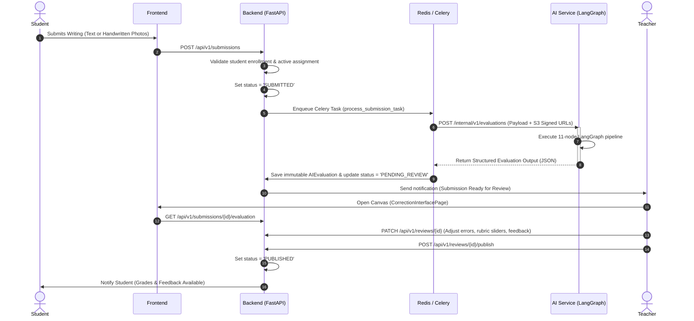

# System Architecture — Get Idiomas AI Writing System

## 1. System Topology & Separation of Concerns

The platform separates business logistics and pedagogical evaluation into two independent, loosely coupled services:

```
[ Frontend: React + TypeScript ]
               │
               ▼ (REST + JWT)
[ Academic Backend: FastAPI + PostgreSQL ]
       │                         ▲
       │ Celery Task             │ Async Response / DB Update
       ▼                         │
[ Worker Queue: Redis ] ──► [ AI Service: LangGraph Engine ]
                                   │
                                   ▼
                         [ Multimodal LLM APIs ]
```

### Decoupling Rules
1. **Frontend Isolation**: The frontend interacts exclusively with the Academic Backend via `/api/v1/*`. It never calls `ai_service` or external LLM providers directly.
2. **AI Service Specialization**: The `ai_service` is stateless with respect to academic entities (does not manage users, courses, or enrollments). It receives an evaluation payload, executes its LangGraph pipeline, and returns structured evaluation data.
3. **Internal Gateway**: The backend calls `ai_service` via an authenticated internal REST endpoint (`POST /internal/v1/evaluations`) executed within background Celery workers.

## 2. Relational Database Schema & Entities

The database schema is organized around core modules in PostgreSQL:

```
+-------------------------------------------------------------+
|                          Identity                           |
+-------------------------------------------------------------+
| User (id, email, password_hash, role, status, timestamps)   |
|   ├── CourseTeacher (course_id, teacher_id)                 |
|   ├── CourseEnrollment (course_id, student_id, status)      |
|   └── StudentLicense (student_id, tier, credits, valid_until|
+-------------------------------------------------------------+
                              │
                              ▼
+-------------------------------------------------------------+
|                     Academic Management                     |
+-------------------------------------------------------------+
| Course (id, name, level, status, created_at)                |
|   └── Assignment (id, course_id, title, writing_type,       |
|                   expected_level, min_words, max_words,     |
|                   due_date, rubric_id, is_active)           |
|                                                             |
| Rubric (id, name, cefr_level, is_template)                  |
|   └── RubricCriterion (id, rubric_id, name, weight, max_band|
+-------------------------------------------------------------+
                              │
                              ▼
+-------------------------------------------------------------+
|                    Submissions & Storage                    |
+-------------------------------------------------------------+
| Submission (id, assignment_id, student_id, type, status,    |
|             current_version, submitted_at)                  |
|   ├── SubmissionFile (id, submission_id, s3_key, file_type, |
|                       mime_type, file_size, sort_order)     |
|   └── SubmissionVersion (id, submission_id, version_number, |
|                          text_content, created_at)          |
+-------------------------------------------------------------+
                              │
                              ▼
+-------------------------------------------------------------+
|                    Evaluation & Reviews                     |
+-------------------------------------------------------------+
| EvaluationJob (id, submission_id, status, error, tokens)    |
|                                                             |
| AIEvaluation (id, submission_id, prompt_version, model,     |
|               transcription_text, corrected_text,           |
|               errors_json, criteria_json, feedback_json,    |
|               suggested_grade, is_immutable, created_at)   |
|                                                             |
| TeacherReview (id, submission_id, ai_evaluation_id,         |
|                teacher_id, final_text, modified_errors,     |
|                final_criteria, final_feedback, final_grade, |
|                status [DRAFT/APPROVED/PUBLISHED], updated_at|
+-------------------------------------------------------------+
```

## 3. Submission Processing Lifecycle



## 4. LangGraph Engine Architecture

The AI processing flow uses a modular `StateGraph` with explicit typed state:

```
                     [ START ]
                         │
                         ▼
             [ Node 1: Input Classifier ]
                         │
           +-------------+-------------+
           │                           │
    (DIGITAL TEXT)               (HANDWRITTEN)
           │                           │
           │                           ▼
           │             [ Node 2: Image Processing ]
           │              (EXIF strip, normalize)
           │                           │
           │                           ▼
           │             [ Node 3: OCR Transcription ]
           │              (Strict literal transcription)
           │                           │
           │                           ▼
           │             [ Node 4: Transcription Check ]
           │              (Completeness & confidence check)
           │                           │
           +-------------+-------------+
                         │
                         ▼
            [ Node 5: Context Preparation ]
             (Combines prompt, CEFR, rubric, guidelines)
                         │
                         ▼
            [ Node 6: Writing Analysis ]
             (Error spotting: grammar, lexis, syntax, style)
                         │
                         ▼
            [ Node 7: Correction Generation ]
             (Diff proposal, Band 5 exemplar rewrite)
                         │
                         ▼
            [ Node 8: Rubric Evaluation ]
             (Scores 0-5 for Content, CA, Org, Language)
                         │
                         ▼
            [ Node 9: Pedagogical Feedback ]
             (Strengths, areas for growth, actionable tips)
                         │
                         ▼
            [ Node 10: Result Validation ]
             (Pydantic schema validation & score sanity check)
                         │
           +-------------+-------------+
           │                           │
       (INVALID)                    (VALID)
           │                           │
           ▼ (Max 2 retries)           ▼
    [ Retry Loop ]             [ Node 11: Final Output ]
                                       │
                                       ▼
                                    [ END ]
```

## 5. Storage Flow & MinIO / S3 Integration

- Submissions requiring file uploads use **Presigned URLs**:
  1. Frontend requests upload authorization: `POST /api/v1/submissions/{id}/files/presign`.
  2. Backend validates permissions and returns a pre-signed S3 `PUT` URL with a 15-minute TTL.
  3. Frontend uploads directly to MinIO/S3.
  4. Frontend notifies backend of upload completion: `POST /api/v1/submissions/{id}/files/confirm`.
  5. Backend generates short-lived presigned `GET` URLs for the `ai_service` multimodal processor.
