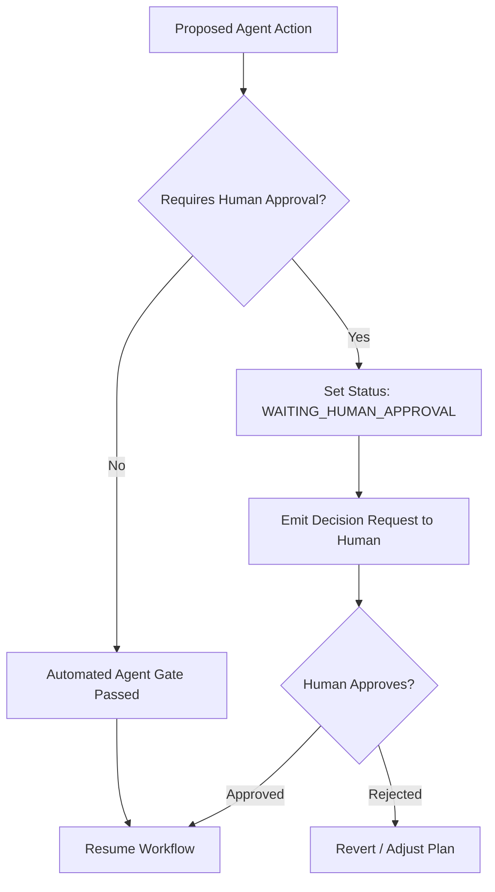

# Approval Policies & Human-in-the-Loop Governance

## 1. Governance Principles

The subagent workflow is designed for high autonomy within bounded constraints. To guarantee safety, compliance, and architectural coherence, explicit gates require **Human-in-the-Loop (HITL)** approval.

When an agent detects a condition requiring human approval, it must immediately suspend execution, set the task status to `WAITING_HUMAN_APPROVAL`, and post a detailed briefing with rationale and alternatives.

## 2. Mandatory Human Approval Triggers

Human approval is strictly mandatory for the following categories:

### 2.1. Architectural Alterations
- Any proposal modifying the boundary between `backend` (FastAPI) and `ai_service` (LangGraph).
- Introduction of direct frontend communication with LLM APIs.
- Replacing or modifying core infrastructure engines (PostgreSQL, Redis, Celery, S3/MinIO).
- Altering the asynchronous queue topology.

### 2.2. Scope & Pedagogical Adjustments
- Any deletion, reordering, or alteration of tasks in `backlog`.
- Any deviation from the Functional Requirements defined in `requirements`.
- Altering Cambridge Assessment English criteria (Content, CA, Org, Language), band descriptors (0-5), or the institutional 10-point conversion formula.
- Changing the visibility policy for the Band 5 exemplar model.

### 2.3. Destructive Database Operations
- Alembic migrations containing table drops (`op.drop_table`), column removals (`op.drop_column`), or non-reversible column type alterations.
- Bulk truncation or irreversible updates to production or staging datasets.

### 2.4. Security, Privacy & Compliance (GDPR / ZDR)
- Any modification to LLM provider Zero Data Retention (ZDR) headers or API settings.
- Modifying or disabling the PII anonymization filter (`core/sanitizer.py`).
- Changes affecting GDPR minor consent records or data erasure workflows.
- Enabling demo mode switches (`DevRoleSwitcher`) in production.

### 2.5. Dependency Additions
- Introducing new third-party Python or npm packages that exceed 10 MB or carry restrictive licenses (e.g., AGPL/GPL).
- Major version upgrades of core frameworks (e.g., FastAPI, LangGraph, React, Pydantic).

## 3. Automated Agent Approval Gates

When none of the triggers in Section 2 are present, workflow progression between agents is automated if all following gates pass:

1. **Schema Validation Gate**: All handoff artifacts (`task_spec.md`, `implementation_report.md`, `test_report.md`, etc.) validate 100% against their corresponding JSON Schemas in `contracts/`.
2. **Quality & Lint Gate**:
   - `ruff check .` passes with 0 errors.
   - `mypy --strict` passes with 0 type errors.
   - `npm run lint` and `tsc --noEmit` pass with 0 errors.
3. **Automated Testing Gate**:
   - All newly implemented unit and integration tests execute successfully.
   - All pre-existing test suites remain completely green (zero regression).
   - Test coverage meets or exceeds established thresholds ($\ge 80\%$).
4. **Git Safety Gate**:
   - Committer verifies no untracked secrets, `.env` files, or temporary binaries exist before committing.

## 4. Human Approval Procedure

When human approval is triggered:
1. Agent updates `state/CURRENT_TASK.md` setting status to `WAITING_HUMAN_APPROVAL`.
2. Agent documents:
   - Specific decision required.
   - Technical justification.
   - Risk assessment and impact analysis.
   - Action plan if approved vs. alternatives if rejected.
3. Once the human user approves (or supplies modifications), the agent records the approval timestamp and resumes the workflow.
