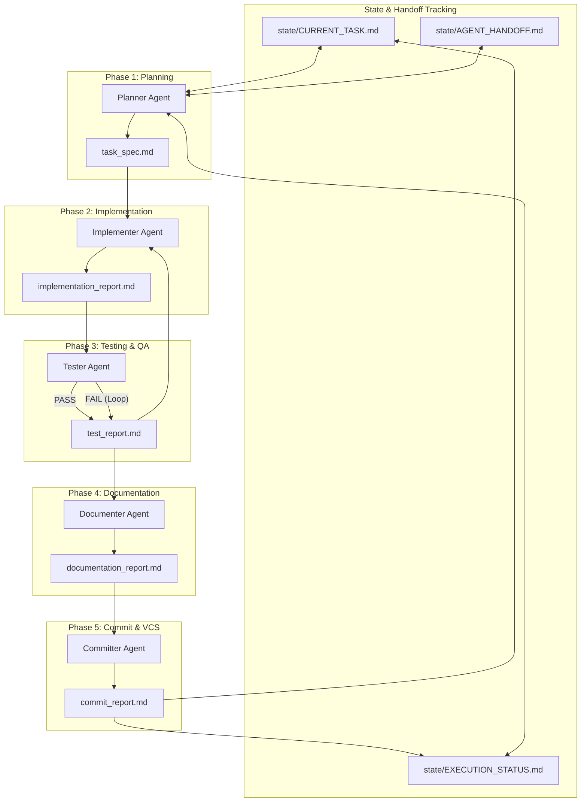

# Development Workflow & Multi-Agent Orchestration

## 1. Multi-Agent Collaboration Model

The multi-agent workflow operates as a deterministic assembly line where each subagent specializes in a single phase of software delivery.

Subagents do not communicate via freeform unstructured chatter; they communicate through structured artifacts, JSON Schema contracts, and standardized handoff state files.

## 2. Shared State Management

Three files under `state/` govern the execution:

1. **`state/CURRENT_TASK.md`**:
   - Represents the active task under execution.
   - Contains task ID, phase, title, current agent assigned, and direct references to produced artifacts.
2. **`state/EXECUTION_STATUS.md`**:
   - High-level progress tracker of the entire backlog across all 7 Phases.
   - Lists task status (`PENDING`, `IN_PROGRESS`, `COMPLETED`, `BLOCKED`).
3. **`state/AGENT_HANDOFF.md`**:
   - The active "baton". When an agent finishes its turn, it writes the handoff payload:
     - `sender`: The completing agent.
     - `recipient`: The next agent in line.
     - `task_id`: Task being processed.
     - `status`: Handoff status (`SUCCESS`, `FAILURE`, `REQUIRES_HUMAN_APPROVAL`).
     - `artifacts`: List of generated files and locations.
     - `context_notes`: Essential technical context for the recipient.

## 3. Step-by-Step Execution Protocol

### Step 1: Planning (Planner)
1. Reads `state/EXECUTION_STATUS.md` and selects the next eligible `PENDING` task respecting phase dependencies.
2. Updates `state/CURRENT_TASK.md` to `PLANNING`.
3. Analyzes requirements (`requirements`), backlog (`backlog`), and codebase (`/backend`, `/ai_service`, `/frontend`).
4. Generates `task_spec.md` following `templates/TASK_SPEC_TEMPLATE.md`.
5. Validates `task_spec.md` against `contracts/task_spec.schema.json`.
6. Checks if human approval is required (see `workflows/APPROVAL_POLICIES.md`):
   - If required $\rightarrow$ halts and alerts human.
   - If not required $\rightarrow$ populates `state/AGENT_HANDOFF.md` targeting `Implementer` and transitions status to `PLANNED`.

### Step 2: Implementation (Implementer)
1. Reads `state/AGENT_HANDOFF.md` and `task_spec.md`.
2. Updates `state/CURRENT_TASK.md` to `IN_IMPLEMENTATION`.
3. Implements required code, schemas, endpoints, or UI features.
4. If database models are altered, creates an Alembic migration script.
5. Writes unit tests corresponding to the new logic.
6. Runs linter and typecheck commands (`ruff check`, `mypy`, `npm run lint`).
7. Generates `implementation_report.md` following `templates/IMPLEMENTATION_REPORT_TEMPLATE.md`.
8. Updates `state/AGENT_HANDOFF.md` targeting `Tester` and transitions status to `IN_TESTING`.

### Step 3: Verification (Tester)
1. Reads `state/AGENT_HANDOFF.md`, `task_spec.md`, and `implementation_report.md`.
2. Updates `state/CURRENT_TASK.md` to `IN_TESTING`.
3. Runs the test suite:
   - Unit tests (`pytest tests/unit`).
   - Integration tests (`pytest tests/integration`).
   - Frontend tests if applicable (`npm test`).
4. Verifies security, authorization rules, and regression risks.
5. Generates `test_report.md` following `templates/TEST_REPORT_TEMPLATE.md`.
6. **Decision Point**:
   - **FAILED**: Populates `state/AGENT_HANDOFF.md` targeting `Implementer` with error logs and failure analysis; transitions task to `REVISION_REQUIRED`.
   - **PASSED**: Populates `state/AGENT_HANDOFF.md` targeting `Documenter` with test summary; transitions task to `IN_DOCUMENTATION`.

### Step 4: Documentation (Documenter)
1. Reads `state/AGENT_HANDOFF.md` and the verified changes.
2. Updates `state/CURRENT_TASK.md` to `IN_DOCUMENTATION`.
3. Updates endpoint docstrings, OpenAPI references, and project markdown files.
4. If an architectural decision was made, creates an ADR under `/docs/adr/`.
5. Appends entries to `CHANGELOG.md` following `templates/CHANGELOG_TEMPLATE.md`.
6. Generates `documentation_report.md` following contract.
7. Populates `state/AGENT_HANDOFF.md` targeting `Committer` and transitions task to `IN_COMMITTING`.

### Step 5: Commit & VCS (Committer)
1. Reads `state/AGENT_HANDOFF.md` and `documentation_report.md`.
2. Updates `state/CURRENT_TASK.md` to `IN_COMMITTING`.
3. Verifies `git status` for untracked artifacts, credentials, or sensitive files (`.env`, secrets).
4. Stages files atomically.
5. Crafts a Conventional Commit message (e.g., `feat(auth): implement JWT login and password recovery`).
6. Commits changes to the branch.
7. Generates `commit_report.md`.
8. Updates `state/EXECUTION_STATUS.md` marking task `COMPLETED`.
9. Resets `state/CURRENT_TASK.md` to ready state for the next task.
