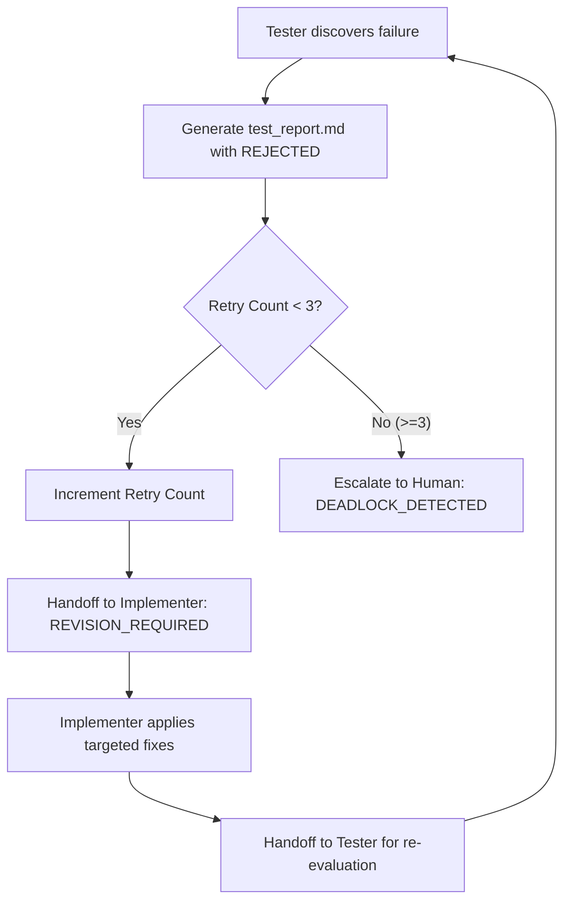

# Error Handling & Incident Resolution Protocols

## 1. Classification of Failures

The multi-agent workflow encounters five primary failure modes:
1. **Verification Failures**: Unit, integration, or regression test failures discovered by the Tester.
2. **Ambiguity / Specification Defects**: Contradictory, missing, or infeasible requirements discovered during planning or coding.
3. **AI Pipeline & Schema Failures**: Malformed LLM outputs, schema validation errors, or multimodal transcription timeouts.
4. **Database & Migration Failures**: Failed Alembic migrations, constraint violations, or database lock deadlocks.
5. **Git & Environment Conflicts**: Dirty working trees, uncommitted artifacts, or dependency incompatibilities.

## 2. Rejection Loop Protocol (Implementer <-> Tester)

When the Tester agent rejects an implementation:

### Protocol Guidelines
1. **Actionable Feedback**: The Tester must include exact stack traces, failed assertions, input payloads, and observed vs. expected behaviors.
2. **Targeted Remediation**: The Implementer must only modify code related to the reported failures, avoiding unrelated refactoring that could introduce new bugs.
3. **Retry Budget**: If the loop exceeds **3 iterations**, the task automatically enters `DEADLOCK_DETECTED` status, requiring human developer intervention.

## 3. Ambiguity & Missing Requirement Resolution

If the Planner or Implementer encounters ambiguous requirements:
1. **Zero Hallucination Rule**: Under no circumstances should an agent invent business rules or speculate on grading formulas.
2. **Pause & Clarify**:
   - The agent writes an explicit RFC in `state/CURRENT_TASK.md` detailing the ambiguity, affected components, and potential options.
   - Sets state to `WAITING_HUMAN_APPROVAL` and requests user input.

## 4. AI Service & LangGraph Resiliency

### 4.1. LLM Output Validation Failures
- The `ai_service` uses Pydantic v2 schemas for all node outputs.
- If an LLM response fails validation (Node 10):
  - **Attempt 1**: Re-invoke the node with the error trace appended to the prompt as feedback.
  - **Attempt 2**: Fall back to a secondary high-precision model (e.g., from Flash to Pro).
  - **If Still Invalid**: Flag `EvaluationJob` with `PROCESSING_FAILED` and generate a high-priority teacher alert for manual intervention.

### 4.2. Low-Confidence or Illegible OCR
- If image quality is too low or text is illegible (confidence $< 50\%$):
  - Do not crash the task.
  - Insert placeholder tags `[ILLEGIBLE_WORD_X]` in `transcription_text`.
  - Add descriptive warnings to `transcription_issues`.
  - Route the submission directly to the teacher's Split View review queue with status `PENDING_REVIEW` and a "Manual OCR Correction Required" badge.

## 5. Database Migration Failures & Rollback

1. **Local Migration Testing**:
   - Implementer must test both `alembic upgrade head` and `alembic downgrade -1` against an ephemeral test database before passing to Tester.
2. **Failure Handling**:
   - If an integration test fails during database migration, the test runner immediately issues a downgrade to restore the schema.
   - The migration file must be corrected and re-verified.

## 6. Git Dirty State & Stash Recovery

1. **Pre-Commit Verification**:
   - Committer runs `git status --porcelain`.
   - If unexpected or untracked files are detected (e.g., `.pytest_cache`, `.DS_Store`, local log files), they must be added to `.gitignore` or cleaned up prior to staging.
2. **Atomic Rollback**:
   - If any step fails during the commit phase, unstaged changes are preserved, no commit is generated, and the error is recorded in `state/CURRENT_TASK.md`.
