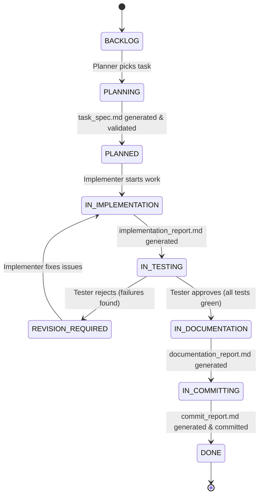

# Task Lifecycle — Get Idiomas AI Writing System

## 1. Overview & State Machine

Every development task progresses through a strict, deterministic lifecycle. No stage may be skipped.

## 2. State Definitions & Exit Criteria

### 2.1. `BACKLOG`
- **Description**: Task is listed in `backlog` with its associated Phase and task code (e.g., `BE-01`, `AI-01`).
- **Entry Criteria**: Defined in `backlog` and linked to `requirements`.
- **Exit Criteria**: Planner claims the task, updates `state/CURRENT_TASK.md`, and transitions status to `PLANNING`.

### 2.2. `PLANNING`
- **Responsible Agent**: **Planner**
- **Activities**:
  - Reviews functional requirements and acceptance criteria.
  - Inspects existing codebase and dependencies.
  - Designs database models, API routes, or AI pipeline nodes.
  - Identifies risks, breaking changes, and testing strategies.
- **Artifact Produced**: `task_spec.md` (validated against `contracts/task_spec.schema.json`).
- **Exit Criteria**: `task_spec.md` is complete, and if architectural changes are present, human approval is granted. Status transitions to `PLANNED`.

### 2.3. `PLANNED`
- **Description**: Task specification is ready for technical implementation.
- **Exit Criteria**: Implementer acknowledges receipt in `state/AGENT_HANDOFF.md` and transitions status to `IN_IMPLEMENTATION`.

### 2.4. `IN_IMPLEMENTATION`
- **Responsible Agent**: **Implementer**
- **Activities**:
  - Writes application code across `/backend`, `/ai_service`, and/or `/frontend`.
  - Creates database migrations (Alembic) if models changed.
  - Implements unit and integration test fixtures.
  - Runs local checks (`ruff`, `mypy`, `tsc`).
- **Artifact Produced**: `implementation_report.md` (validated against `contracts/implementation_report.schema.json`).
- **Exit Criteria**: Implementation report completed with list of modified files. Status transitions to `IN_TESTING`.

### 2.5. `IN_TESTING`
- **Responsible Agent**: **Tester**
- **Activities**:
  - Executes unit, integration, and API test suites.
  - Runs security, type, and lint checks.
  - Verifies backward compatibility and checks for regressions.
- **Artifact Produced**: `test_report.md` (validated against `contracts/test_report.schema.json`).
- **Exit Criteria**:
  - **APPROVED**: 100% tests pass, zero regressions $\rightarrow$ Transition to `IN_DOCUMENTATION`.
  - **REJECTED**: Any test failure or DoD violation $\rightarrow$ Transition to `REVISION_REQUIRED`.

### 2.6. `REVISION_REQUIRED` (Rejection Loop)
- **Description**: Implementer receives the `test_report.md` with failure details, reproduction steps, and required fixes.
- **Constraint**: Maximum 3 correction iterations allowed before escalating to human supervisor.
- **Exit Criteria**: Implementer completes fixes and returns task to `IN_TESTING`.

### 2.7. `IN_DOCUMENTATION`
- **Responsible Agent**: **Documenter**
- **Activities**:
  - Updates API documentation (OpenAPI schemas, endpoint docstrings).
  - Updates architecture docs or creates ADRs if relevant.
  - Appends task completion entry to changelog.
- **Artifact Produced**: `documentation_report.md` (validated against `contracts/documentation_report.schema.json`).
- **Exit Criteria**: All docs synchronized. Status transitions to `IN_COMMITTING`.

### 2.8. `IN_COMMITTING`
- **Responsible Agent**: **Committer**
- **Activities**:
  - Reviews `git status` and `git diff` for stray files, debug logs, or exposed secrets.
  - Stages modified files in logical atomic groupings.
  - Writes commit message conforming strictly to Conventional Commits.
  - Executes git commit.
- **Artifact Produced**: `commit_report.md` (validated against `contracts/commit_report.schema.json`).
- **Exit Criteria**: Clean working tree. Status transitions to `DONE`.

### 2.9. `DONE`
- **Description**: Task is fully delivered, meeting all criteria in `DEFINITION_OF_DONE.md`.
- **Activities**: Updates `state/EXECUTION_STATUS.md` and clears/archives `state/CURRENT_TASK.md`.
